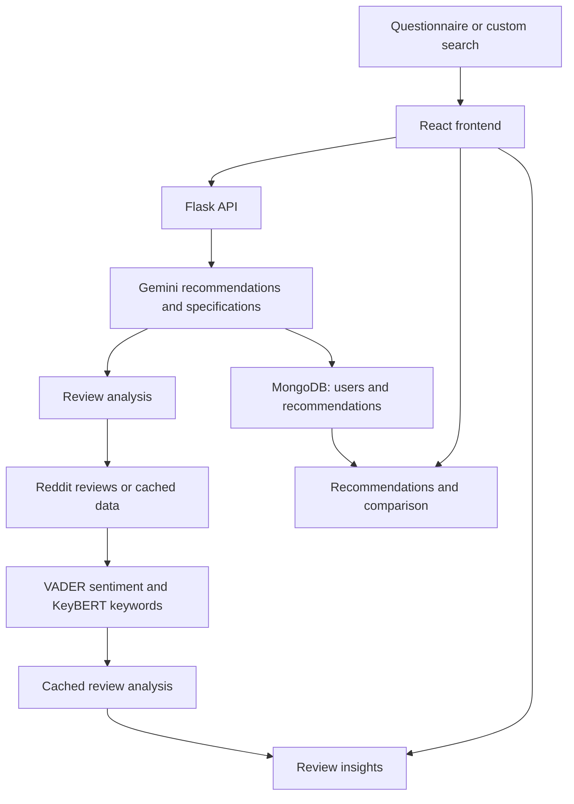

# SmartSelect: Tech, Chosen Right

SmartSelect helps users compare Lenovo laptops using their needs, product specifications, and review insights. It is a student project built with React, Flask, Gemini, and MongoDB.

## Features

- Guided questionnaire and free-form laptop search
- AI-generated Lenovo recommendations with estimated prices and explanations
- Laptop specification details and side-by-side comparison
- Account signup/login, saved recommendations, and wishlist
- Review sentiment, keywords, and user-group summaries

## Flow Diagram



## Tech Stack

- **Frontend:** React, React Router, Axios, Recharts
- **Backend:** Python, Flask
- **AI:** Google Gemini API
- **Database:** MongoDB
- **Review analysis:** PRAW, VADER, NLTK, KeyBERT, Sentence Transformers

## Setup

### Requirements

- Python 3.10 or later
- Node.js and npm
- MongoDB connection string
- Two Gemini API keys

### Backend configuration

From the project root, create a virtual environment and install dependencies:

```powershell
py -m venv .venv
.\.venv\Scripts\Activate.ps1
python -m pip install --upgrade pip
pip install -r backend\requirements.txt
```

Create `backend/.env`:

```dotenv
MONGO_URI=mongodb+srv://<username>:<password>@<cluster>/<database>
DB_NAME=smartselect
SECRET_KEY=<a-long-random-secret>
```

Create `backend/keys.env`:

```dotenv
API_KEY_FIRST=<your-first-gemini-api-key>
API_KEY_SECOND=<your-second-gemini-api-key>
```

Keep these files private and do not commit credentials.

### Run the backend

```powershell
cd backend
python backend.py
```

The API runs at `http://127.0.0.1:5000`.

### Run the frontend

In a second terminal:

```powershell
cd frontend
npm install
npm start
```

Open `http://localhost:3000`.

## Configuration Notes

- The main frontend API URL is set in `frontend/src/App.jsx` and currently points to the hosted API. Set it to `http://127.0.0.1:5000` for local development.
- The review panel calls `http://localhost:5000` directly, so keep the local backend running to view review analysis.
- To fetch fresh Reddit reviews, add `REDDIT_CLIENT_ID`, `REDDIT_CLIENT_SECRET`, and `REDDIT_USER_AGENT` to `backend/reviews/reviews.env`.
- Prices are estimates, not live retailer listings. Recommendations currently focus on Lenovo laptops.
- YouTube collection code is present but is not enabled in the active review-analysis pipeline. If no reviews are found, the backend may return placeholder analysis.

## Project Structure

```text
backend/    Flask API, recommendation logic, MongoDB access, review analysis
frontend/   React application and UI components
tests/      Development and performance test scripts
```

## Commands

Run from `frontend/`:

```bash
npm test       # Run the frontend test runner
npm run build  # Build the frontend into frontend/build/
```

## Academic Project

TY CSE Mini Project 1 (7CS345), Computer Science and Engineering, Walchand College of Engineering, Sangli, 2025-2026.

**Team:** Huma Naaz Mohammad (23510053), Dhriti Shah (23510083), and Aditi Mittal (23610067).  
**Guide:** Mr. Siddharaj D. Pujari.
